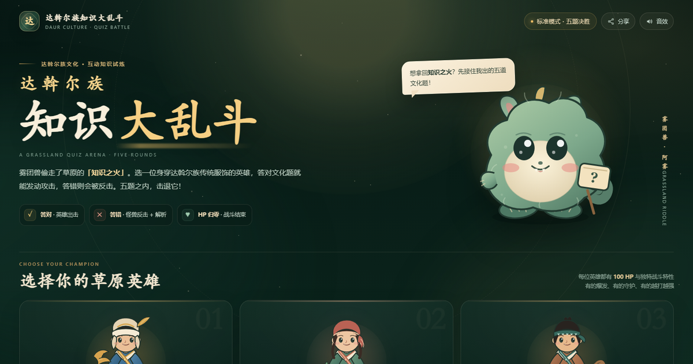

# 达斡尔族知识大乱斗 · 赤焰试炼

在线试玩：[https://x15737876973-art.github.io/daur-quiz/](https://x15737876973-art.github.io/daur-quiz/)

一个单页的达斡尔族文化知识答题战斗小游戏：**5 位英雄、每位 5 套可换衣装、100 道文化题，每局从当前英雄的专属题库随机抽取 10 道。**

玩家选择射手、法师或战士，与雾团兽「阿雾」进行十题知识对决：

- 答对：英雄施展本职业专属攻击，雾团兽扣血，并出现痛苦表情。
- 答错：雾团兽突进到英雄面前使用兽爪攻击，再退回原位。
- 任意一方 HP 归零即结算；若十题结束双方仍存活，则按剩余生命比例判定胜负。
- 每题作答后都会显示正确答案与解析。

## 五位英雄与职业

| 英雄 | 职业 | 专属特性 |
| --- | --- | --- |
| 莫日根 | 射手 | 鹰眼：本局第一次答对必定暴击，射出 43 点伤害的赤羽箭。 |
| 塔娜 | 射手 | 连珠箭：连续答对时每箭额外 +6 伤害，答错重置。 |
| 库木勒 | 法师 | 柳芽护盾：每次答对获得 7 点护盾，最多 28 点，优先抵挡兽爪。 |
| 乌春 | 法师 | 星火共鸣：每第三次答对追加 16 点星火伤害。 |
| 贝阔 | 战士 | 圣剑裁决：每第三次答对伤害翻倍，劈出 60 点至圣伤害。 |

## 衣装与题库

- 每位英雄有 **5 套衣装**，共 25 套；款式、配色、披风/短袄/披巾/战袍/斗篷结构会随之变化。
- 题库共 **100 道**，分为 5 个互不重复的 20 题专属题库；每位英雄只会抽到自己的 20 题中的 10 题。
- 每局开始重新随机抽题并打乱选项，重玩不会固定顺序。

## 操作

- 点击选项即可作答。
- 也可以按 A / B / C / D 或 1 / 2 / 3 / 4 选择答案。
- 右上角可开启/关闭音效，也可复制分享链接。
- 「重新选择」可随时回到英雄与衣装选择页。

## 技术

纯单文件 HTML + CSS + JavaScript，无外部依赖。角色、怪兽与武器均为内联 SVG；攻击特效由 CSS 动画分层合成；音效使用 Web Audio API 程序化合成，并通过压缩器与混响控制响度。

## 文化说明

题目取材于达斡尔族传统体育、节庆饮食、说唱艺术、服饰工艺与聚居地文化。参考资料：

- 中国新闻网《探访“中国曲棍球之乡”》
- 梅里斯达斡尔族区人民政府民族节日资料
- 讷河市融媒体中心达斡尔族节庆文化资料
